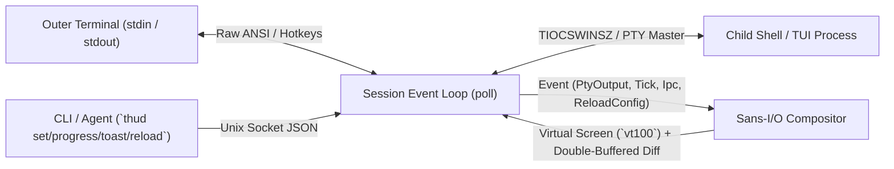

# thud — Terminal Heads Up Display

**`thud` (Terminal Heads Up Display)** is a terminal-emulator-agnostic and shell-agnostic HUD & compositor written in Rust.

It wraps any interactive shell (`fish`, `zsh`, `bash`, `nu`, etc.) inside a transparent pseudo-terminal (PTY) compositor and renders:
- A **Vim-like docked bottom status line** with themed capsules, transparent/RGBA-blended backgrounds, Git/CWD/CPU/battery telemetry, event-driven project commands, and slow-command timers.
- **Non-destructive floating overlays** (top-right clock, bordered HUD panels) that automatically dodge the cursor or underlying terminal text and never corrupt scrollback or copy-paste buffers.
- **Live IPC widgets** (`ipc_slot`, `sparkline`, `gauge`, and floating `toast` notifications) controllable from any shell script, CI/CD job, or AI coding agent via a Unix domain socket.

---

## Documentation

- **[Usage & IPC Guide (`guides/usage.md`)](./guides/usage.md)** — Starting sessions, hotkeys, CLI subcommands (`set`, `progress`, `toast`, `reload`, `quit`), raw JSON socket protocol, and shell integration recipes.
- **[Configuration Reference (`guides/configuration.md`)](./guides/configuration.md)** — Complete reference for every `config.toml` option, theme palette override, color/alpha syntax, widget type, and collision policy.

---

## Key Features

### 1. Docked Status Bar & Native Transparency
- Reserves bottom rows via `TIOCSWINSZ` so your shell and full-screen TUI apps (`vim`, `nvim`, `less`, `fzf`) naturally size themselves above the status bar.
- **Native Terminal Transparency & RGBA Blending**: Built-in themes default `bar_bg = "transparent"` so terminal emulator window opacity and blur (Ghostty `background-opacity`, WezTerm, Kitty) shine right through. Any color also supports `#rrggbbaa` or `@<opacity>` (`"#24283b@75%"`, `"blue@50%"`) for in-buffer RGB alpha blending.
- **7 Built-in Themes + Full Palette Customization**: `"tokyo_night"` (default), `"catppuccin"`, `"cyberpunk"`, `"nord"`, `"gruvbox"`, `"github_dark"`, and `"default"`, with per-color overrides via `[theme]`.

### 2. Non-Destructive Floating Overlays & Smart Collision Avoidance
- **Anchor anywhere**: `top_right`, `top_left`, `top_center`, `bottom_right`, `bottom_left`, `bottom_center`.
- **Box-drawing borders**: `none`, `single` (`┌─┐`), `rounded` (`╭─╮`), or `double` (`╔═╗`) with optional titles.
- **Text & Cursor Dodge**: Overlays automatically detect both the active cursor position and non-empty terminal cells inside their bounding box, dodging to the opposite corner or hiding cleanly without leaving artifacts.
- **CJK Wide-Character Healing**: Tracks 2-cell East Asian wide characters so overlays never leave torn half-glyphs on boundary columns.

### 3. Built-in Telemetry, Event-Driven Commands & Live IPC Widgets

| Widget `type` | Description |
| :--- | :--- |
| `cwd` | Current working directory of the child shell (`~` abbreviated, zero shell hooks required). |
| `git_branch` | Current Git branch (`HEAD`) resolved from the active directory. |
| `active_command` | Monitors the foreground process in the PTY and displays `⚙ <cmd> (<elapsed>s)` once it runs for `>= min_secs`. |
| `clock` | Local wall-clock time formatted with `chrono` `strftime` syntax (e.g., `" %H:%M:%S "`). |
| `command` | Runs `sh -c "<cmd>"` in the child shell's `cwd`. Defaults to event-driven `trigger = "change"` (runs on `cwd` change & command completion, with optional `when_files = ["Cargo.toml"]` filter) or periodic `trigger = "interval"`. |
| `ipc_slot` | Displays arbitrary text pushed via `thud set <key> <value> [--ttl-ms <ms>]`. |
| `sparkline` | Rolling Unicode block mini-graph (`▁▂▃▄▅▆▇█`) with optional `label`. Supports built-in `key = "cpu"` / `"battery"`, `thud progress <key> <0..100>`, or `cmd`. |
| `gauge` | Horizontal progress/metric bar (`━━━━──  75%`) with 3-char left-padded percentage and optional `label`. Supports built-in `key = "battery"` / `"cpu"`, `thud progress <key> <0..100>`, or `cmd`. |
| `text` | Static text label. |

### 4. Floating Toast & Ad-Hoc Progress Stack (`[toast]`)
- Trigger floating notifications from any terminal, hook, or background task:
  ```sh
  thud toast "Cargo build succeeded" --level success --ttl-ms 4000
  ```
- Pushing an unconfigured key via `thud progress <key> <0..100>` automatically displays a temporary floating progress gauge above the toast stack until `thud progress <key> done`.
- Configurable `anchor`, `margin_x`, `margin_y`, `gap`, `pill`, and `border`.

### 5. Live Configuration Reload & Hotkeys
- **Auto-reload on save**: Saving `~/.config/thud/config.toml` automatically reloads the HUD within 250ms (showing an error toast if TOML syntax is invalid while keeping the current config active).
- **`Ctrl+\`** (`zen_toggle_key`): Toggle **Zen Mode** (instantly hide/show all HUD chrome).
- **`Ctrl+]`** (`reload_key`) or `thud reload`: Manually reload `config.toml` at any time.

### 6. High-Performance Frame Pacing & Zero-Allocation UI Engine
- **Decoupled PTY Ingestion & 144 FPS Frame Pacing**: High-bandwidth child output (e.g. streaming logs) is ingested immediately into the virtual screen parser without stalling the child shell, while frame composition is paced at up to ~144 FPS (6.9ms).
- **0ms Keystroke Latency**: Interactive user typing immediately flushes rendered diffs to the outer terminal for zero interactive latency.
- **Zero-Allocation Flat 2D Grid**: Screen buffer uses inline scalar `char` cells with double-buffering, eliminating heap allocations during continuous terminal rendering.
- **Run-Length Cursor Tracking**: Minimizes ANSI Cursor Position (`CUP`) escapes across contiguous cells, reducing terminal diff byte size by 60–80%.
- **Fail-Safe Session Lifecycle**: Live Unix domain socket checking and TTY identity tracking (`$THUD_TTY`) prevent accidental nested lockouts, auto-purge stale environment variables from terminated sessions, support `--force` / `-f` override, and guarantee idempotent `thud quit`.

---

## Architecture

`thud` follows deep module design principles with strict decoupling:
- **Sans-I/O `Compositor` Core** (`src/compositor/`): Pure state machine that processes inputs (`step`) and renders double-buffered diffs (`render`), completely free of OS I/O or system clock queries.
- **Declarative `Session` Runner** (`src/session/`): Manages the poll event loop, dynamic poll timeouts (0ms when dirty, up to 50ms when idle), OS signal handling (`SIGWINCH`, `SIGTERM`, `SIGHUP`, `SIGINT`), non-blocking PTY/IPC I/O, and fail-safe nested session auto-healing.
- **2D UI Buffer & Widget Seam** (`src/ui/`): Zero-allocation flat 2D `Cell` grid with inline scalar `char` storage, CJK wide-character boundary healing, and run-length cursor-tracked ANSI diff generation.
- **Asynchronous Telemetry & Caching** (`src/session/probes.rs`): CWD-memoized Git branch resolution and non-blocking background worker thread for battery probes.



---

## Installation

Build and install from source using Cargo:

```sh
cargo install --path .
```

---

## Quick Start

### 1. Generate a Default Configuration File
Write the annotated default configuration to `~/.config/thud/config.toml`:

```sh
thud init-config
```

### 2. Start a `thud` Session
Launch your default `$SHELL` with the HUD enabled:

```sh
thud
```

### 3. Interact with the HUD via IPC
Inside a running `thud` session:

```sh
# 1. Push a status slot onto the default status bar
thud set status "🤖 Claude: running tests..." --ttl-ms 10000

# 2. Pop up an ad-hoc floating progress gauge (0..100)
for p in 15 45 80 100; do
  thud progress build "$p" --label "cargo test"
  sleep 0.3
done
thud progress build done

# 3. Trigger floating toast notifications
thud toast "All tests passed!" --level success --ttl-ms 4000

# 4. Reload config.toml manually (or just save the file in your editor!)
thud reload
```

---

## CLI Summary

| Command | Description |
| :--- | :--- |
| `thud [run] [--config <path>] [--shell <cmd>] [--force]` | Start an interactive `thud` HUD session. Protected against nested sessions with auto-healing for stale parent environments; `--force` (`-f`) overrides. |
| `thud init-config [--output <path>] [--force]` | Write an annotated default `config.toml` to `~/.config/thud/config.toml`. |
| `thud print-default-config` | Print the annotated default `config.toml` to stdout. |
| `thud reload` | Reload `config.toml` in the active session immediately. |
| `thud set <key> <value> [--ttl-ms <ms>]` | Set an `ipc_slot` widget value in the active session. |
| `thud clear <key>` | Clear an `ipc_slot`, `gauge`, or `sparkline` key. |
| `thud progress <key> <0..100\|done> [--label <text>] [--ttl-ms <ms>]` | Push a percentage sample (`0..100`) to `gauge` and `sparkline` widgets (or pop up a floating progress bar). |
| `thud toast <message> [--level info\|success\|warn\|error] [--ttl-ms <ms>]` | Display a floating toast notification. |
| `thud quit` | Gracefully terminate the active `thud` session (idempotent: exits cleanly and purges stale session variables if no session is running). |

---

## Default Configuration (`~/.config/thud/config.toml`)

```toml
theme = "tokyo_night"
zen_toggle_key = "ctrl-\\"
reload_key = "ctrl-]"

[status_bar]
enabled = true
position = "bottom"
height = 1
separator = ""

left = [
    { type = "cwd", padding = true, bold = true },
    { type = "git_branch", padding = true, bold = true },
    { type = "active_command", min_secs = 2, padding = true, bold = true },
    { type = "ipc_slot", key = "status", padding = true, bold = true },
]
center = []
right = [
    { type = "sparkline", key = "cpu", width = 8, label = "CPU", padding = true },
    { type = "gauge", key = "battery", width = 6, padding = true },
]

[toast]
anchor = "bottom_right"
margin_x = 2
margin_y = 1
gap = 0
pill = false
border = "none"

[[overlays]]
id = "clock"
anchor = "top_right"
offset_x = 0
offset_y = 0
z_index = 10
screen_mode = "always"
border = "none"
padding_x = 0
bold = true
collision = { mode = "dodge_to_opposite_corner", margin = 1, avoid_text = true }
widgets = [
    { type = "clock", format = " %H:%M:%S " },
]
```

For all options, theme overrides, event-driven `command` triggers, and opacity settings, see **[`guides/configuration.md`](./guides/configuration.md)** and **[`guides/usage.md`](./guides/usage.md)**.

---

## Testing & Verification

```sh
make test
```

`make test` runs:
1. `okf validate docs --strict --drift` (OKF knowledge bundle verification)
2. `cargo fmt --check`
3. `cargo clippy --all-targets -- -D warnings`
4. `cargo test` (27 unit tests + PTY E2E test suite)
