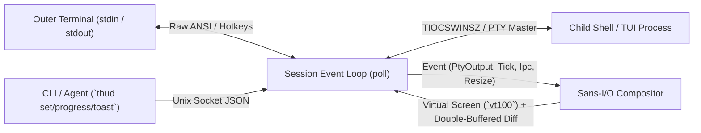

# thud — Terminal Heads Up Display

**`thud` (Terminal Heads Up Display)** is a terminal-emulator-agnostic and shell-agnostic HUD & compositor written in Rust.

It wraps any interactive shell (`fish`, `zsh`, `bash`, `nu`, etc.) inside a transparent pseudo-terminal (PTY) compositor and renders:
- A **Vim-like docked bottom status line** with capsule segments, 256-color styling, Git/CWD/battery telemetry, and live foreground command duration timers.
- **Non-destructive floating overlays** (top-right clock, bordered HUD panels, on-demand dashboards) that automatically dodge the cursor or underlying terminal text and never corrupt scrollback or copy-paste buffers.
- **Live IPC widgets** (`ipc_slot`, `sparkline`, `gauge`, and stacked `toast` notifications) controllable from any shell script, CI/CD job, or AI coding agent via a Unix domain socket.

---

## Key Features

### 1. Non-Destructive Floating Overlays & Smart Collision Avoidance
- **Anchor anywhere**: `top_left`, `top_right`, `bottom_left`, `bottom_right`.
- **Box-drawing borders**: `none`, `single` (`┌─┐`), `rounded` (`╭─╮`), or `double` (`╔═╗`) with optional panel titles.
- **Text & Cursor Dodge**: When `on_cursor_collision = "dodge_to_opposite_corner"` or `"auto_hide"` is set, overlays automatically detect both the active cursor position and any non-empty underlying terminal cells inside their bounding box, getting out of your way immediately and restoring the original terminal cells underneath without leaving artifacts.
- **Alternate Screen Awareness**: Automatically hides floating overlays when full-screen TUI applications (`vim`, `nvim`, `less`, `htop`, `fzf`) enter the alternate screen buffer (`\x1b[?1049h`), or keeps them visible with `show_on = "always"`.
- **CJK Wide-Character Healing**: Properly tracks 2-cell East Asian wide characters so overlays and status bars never leave torn half-glyphs on boundary columns.

### 2. Docked Status Bar (`[status_bar]`)
- Reserves bottom rows via `TIOCSWINSZ` so your shell and TUI apps naturally size themselves above the status bar.
- Supports left, center, and right aligned widget groups (`left_widgets`, `center_widgets`, `right_widgets`).
- Per-segment 256-color styling (`fg_ansi`, `bg_ansi`, `bold`) and custom `prefix` / `suffix` strings for Powerline / rounded Nerd Font capsules.

### 3. Built-in Telemetry & Live IPC Widgets
| Widget `kind` | Description |
| :--- | :--- |
| `cwd` | Current working directory of the foreground process group (via OS procfs / `proc_pidinfo`, zero shell hooks required). |
| `git_branch` | Current Git branch (`HEAD`) and dirty working-tree indicator (`*`). |
| `active_command` | Monitors the foreground process running in the PTY and displays `[running: <cmd> 12s]` once it exceeds `min_duration_ms`. |
| `battery` | Battery percentage and charging status (`+` / `-`) on macOS (`pmset`) and Linux (`/sys/class/power_supply`). |
| `clock` | Current local time (`HH:MM:SS`). |
| `command` | Periodically executes a background shell command (`command`, `interval_ms`) without blocking keystrokes. |
| `ipc_slot` | Displays arbitrary text pushed via `thud set <key> <value> [--ttl-ms <ms>]`. |
| `sparkline` | Renders a historical Unicode block mini-graph (`▁▂▃▄▅▆▇█`) fed by `thud progress <key> <0..100>` or `command` output. |
| `gauge` | Renders a smooth fractional block progress bar (`████▌░░░ 56%`) fed by `thud progress <key> <0..100>`. |
| `text` | Static text label. |

### 4. Stacked Toast Notification Queue
- Trigger transient pop-up notifications from any terminal or background task:
  ```sh
  thud toast "Cargo build succeeded" --level success --ttl-ms 4000
  ```
- Supports `info`, `success`, `warn`, and `error` color themes with automatic expiration.

### 5. Instant Keyboard Shortcuts
- **`Ctrl+\`** (`0x1c`): Toggle **Zen Mode** (instantly hide/show all HUD chrome for clean copy-pasting or screen sharing).
- **`Ctrl+]`** (`0x1d`): Toggle **Dashboard Mode** (pop up overlays configured with `toggle_only = true` on demand).

---

## Architecture

`thud` is built around a **Sans-I/O `Compositor` state machine** (`src/compositor.rs`) decoupled from OS PTY/socket event loops (`src/session.rs`).



---

## Installation

Build and install from source using Cargo:

```sh
cargo install --path .
```

Or build the release binary directly:

```sh
cargo build --release
./target/release/thud --help
```

---

## Quick Start

### 1. Generate a Default Configuration File

`thud` includes a self-documenting configuration generator that writes all available options and examples to `~/.config/thud/config.toml`:

```sh
thud init-config
```

### 2. Start a `thud` Session

Run `thud` to launch your default `$SHELL` with the HUD enabled:

```sh
thud
```

Or specify a custom shell or config file:

```sh
thud --shell /opt/homebrew/bin/fish --config ~/.config/thud/config.toml
```

### 3. Interact with the HUD via IPC

Inside a running `thud` session (or from another terminal targeting the socket), try pushing live updates:

```sh
# 1. Push a status slot with a 10-second TTL
thud set agent "Claude: running tests..." --ttl-ms 10000

# 2. Update a live progress bar / sparkline (0..100)
for p in 15 40 75 100; do
  thud progress build "$p" --label "cargo test"
  sleep 0.4
done
thud progress build done

# 3. Pop up stacked toast notifications
thud toast "All tests passed!" --level success --ttl-ms 4000
thud toast "High memory pressure detected" --level warn --ttl-ms 5000

# 4. Cleanly exit the thud session
thud quit
```

---

## CLI Reference

| Command | Description |
| :--- | :--- |
| `thud [run] [--config <path>] [--shell <cmd>]` | Start an interactive `thud` HUD session. |
| `thud init-config [--output <path>] [--force]` | Write an annotated default `config.toml` to `~/.config/thud/config.toml`. |
| `thud print-default-config` | Print the annotated default `config.toml` to stdout. |
| `thud set <key> <value> [--ttl-ms <ms>]` | Set an `ipc_slot` widget value in the active session. |
| `thud clear <key>` | Clear an `ipc_slot`, `gauge`, or `sparkline` key. |
| `thud progress <key> <0..100\|done> [--label <text>] [--ttl-ms <ms>]` | Push a percentage sample (0..100) to `gauge` and `sparkline` widgets. |
| `thud toast <message> [--level info\|success\|warn\|error] [--ttl-ms <ms>]` | Display a transient bordered toast notification in the top-right corner. |
| `thud quit` | Gracefully terminate the active `thud` session. |

### Configuration Resolution Order
1. `--config <path>` (or `-c <path>`) CLI flag
2. `$THUD_CONFIG` environment variable
3. `$XDG_CONFIG_HOME/thud/config.toml`
4. `~/.config/thud/config.toml`
5. Built-in default (`Config::default()`)

---

## Showcase Configuration (`~/.config/thud/config.toml`)

Below is a full-featured HUD configuration powered by the `src/ui/` component foundation — featuring `theme = "tokyo_night"`, automatic accent capsules (`icon`, `padding`, `pill`), automatic slow-command timer, live CPU sparkline, build progress gauge, a bordered top-right clock, and a multi-widget `Ctrl+]` system dashboard:

```toml
# Built-in themes: "default" | "tokyo_night" | "catppuccin" | "cyberpunk" | "nord" | "gruvbox"
theme = "tokyo_night"

zen_toggle_key = "ctrl-\\"
dashboard_toggle_key = "ctrl-]"

[status_bar]
enabled = true
height = 1
separator = " "

# Left: CWD capsule + Git branch capsule + slow-command timer (>= 2s)
# Theme automatically assigns accent colors per widget type, or override with `fg` / `bg`!
left = [
    { type = "cwd", icon = "📁", padding = true, bold = true },
    { type = "git_branch", icon = "🌿", padding = true, bold = true },
    { type = "active_command", min_secs = 2, padding = true, bold = true },
]

# Center: Live IPC slot + build progress gauge
center = [
    { type = "ipc_slot", key = "agent", icon = "🤖", fg = "white", bg = "purple", padding = true, bold = true },
    { type = "gauge", key = "build", width = 10, label = "Build", icon = "🚀", padding = true },
]

# Right: CPU load sparkline + Battery capsule
right = [
    { type = "sparkline", key = "cpu", width = 8, icon = "CPU", padding = true },
    { type = "battery", icon = "🔋", padding = true, bold = true },
]

# Floating Top-Right Rounded Clock (dodges cursor & terminal text)
[[overlays]]
id = "top_right_clock"
anchor = "top_right"
offset_x = 1
offset_y = 0
border = "rounded"
title = " TIME "
border_fg = "cyan"
title_fg = "yellow"
padding_x = 1
screen_mode = "primary_only"
collision = { mode = "dodge_to_opposite_corner", margin = 1, avoid_text = true }
widgets = [
    { type = "clock", format = "%H:%M:%S" },
]

# On-Demand Multi-Widget System Dashboard (Toggle with Ctrl+])
[[overlays]]
id = "sys_dashboard"
anchor = "bottom_right"
offset_x = 2
offset_y = 1
border = "double"
title = " SYSTEM HUD (Ctrl+]) "
border_fg = "magenta"
title_fg = "cyan"
padding_x = 1
screen_mode = "dashboard_only"
collision = { mode = "dodge_to_opposite_corner", margin = 1, avoid_text = true }
widgets = [
    { type = "command", id = "load", cmd = "uptime | sed 's/.*load averages: /Load: /'", interval_ms = 3000 },
    { type = "sparkline", key = "cpu", width = 12, icon = "CPU" },
    { type = "gauge", key = "build", width = 12, label = "Task" },
]
```

---

## Testing & Verification

`thud` ships with both deterministic unit tests for the Sans-I/O `Compositor` and a full PTY End-to-End (`OuterTerminalSimulator`) test suite that spawns real `thud` binaries in a pseudo-terminal and verifies the rendered `vt100` screen cells:

```sh
make test
```

`make test` runs:
1. `okf validate docs --strict --drift` (knowledge bundle verification)
2. `cargo fmt --check`
3. `cargo clippy --all-targets -- -D warnings`
4. `cargo test` (16 unit tests + PTY E2E test suite)
