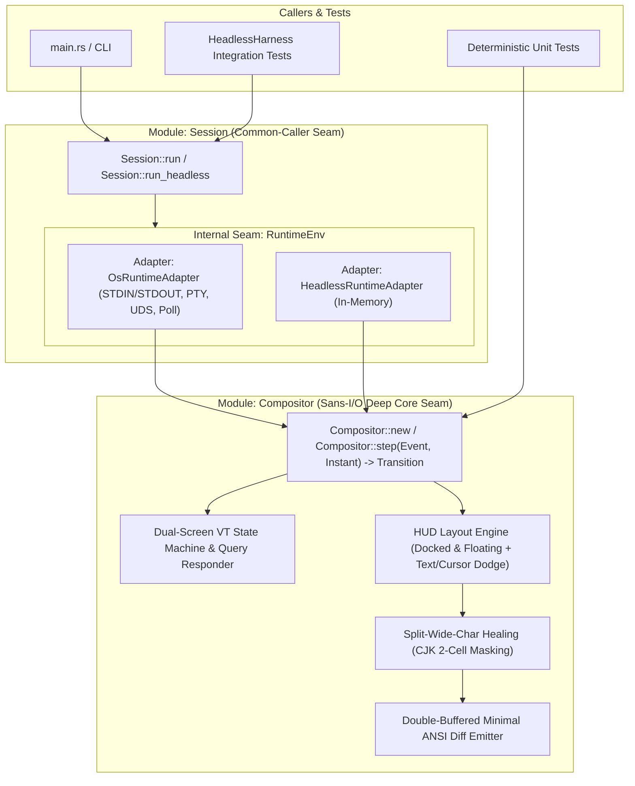

## Architecture Overview

Following the `codebase-design` principles, `cth` avoids splitting terminal emulation, layout calculation, wide-character healing, widget state merging, and ANSI diff rendering into shallow pass-through modules. Instead, all pure computation and screen state live inside a single **In-process Deep Module** (`Compositor`), wrapped by an ergonomic `Session` runner with an **Internal Seam** for OS I/O.

## Core Seams and Interfaces

### 1. Inner Deep Module: `Compositor` (In-Process Seam)

- **Interface**:
  - `Compositor::new(host_size: TermSize, config: Config, now: Instant) -> Result<(Self, Transition), ConfigError>`
  - `Compositor::step(&mut self, event: Event<'_>, now: Instant) -> Transition`
- **What sits behind the seam (Implementation)**:
  - Stateful UTF-8 and VT100/xterm parser across arbitrary byte chunk splits.
  - Terminal capability/status query responder (`Transition::child_pty_input`) replying to `DA1` (`\x1b[c` / `\x1b[0c`), `DA2` (`\x1b[>c`), `DSR 5/6` (`\x1b[5n` / `\x1b[6n`), `XTVERSION` (`\x1b[>0q`), Kitty keyboard queries (`\x1b[?u`), and `OSC 10/11` color queries so modern shells like `fish` start without delay or warnings.
  - Primary and Alternate (`?1049h`/`?1049l`) cell grids, scroll regions (`DECSTBM`), and cursor state.
  - Docked status bar (reserving rows via `Transition::child_pty_resize`) and floating overlays with cursor and underlying non-whitespace text collision dodging (`CollisionPolicy::AutoHide` or `DodgeToOppositeCorner { margin, avoid_text }`).
  - Split-wide-character healing when an overlay edge lands on half of a 2-cell CJK character.
  - Double-buffered cell diffing that emits minimal ANSI sequences (`Transition::host_ansi_diff`) and restores the child's exact cursor coordinates and visibility.

### 2. Outer Module: `Session` (Caller Seam + Internal OS Seam)

- **External Interface**:
  - `Session::run(config: Config) -> Result<i32, SessionError>` for production CLI startup.
  - `Session::run_headless(config: Config, cols: u16, rows: u16) -> Result<HeadlessHarness, SessionError>` for multi-step integration tests.
- **Internal Seam & OS Constraints**:
  - On macOS (XNU), `poll(2)` on `/dev/tty` immediately returns `POLLNVAL (0x20)` rather than `POLLIN`. `OsHostTerminal` therefore polls and configures `STDIN_FILENO` (`0`) directly (which references the underlying slave PTY device) and writes diffs to `STDOUT_FILENO` (`1`).

# Related Concepts
- [Core Terminal HUD & Compositor Requirements](../requirements/core-hud-capabilities.md): satisfies core terminal HUD, full-screen overlay, and widget requirements
