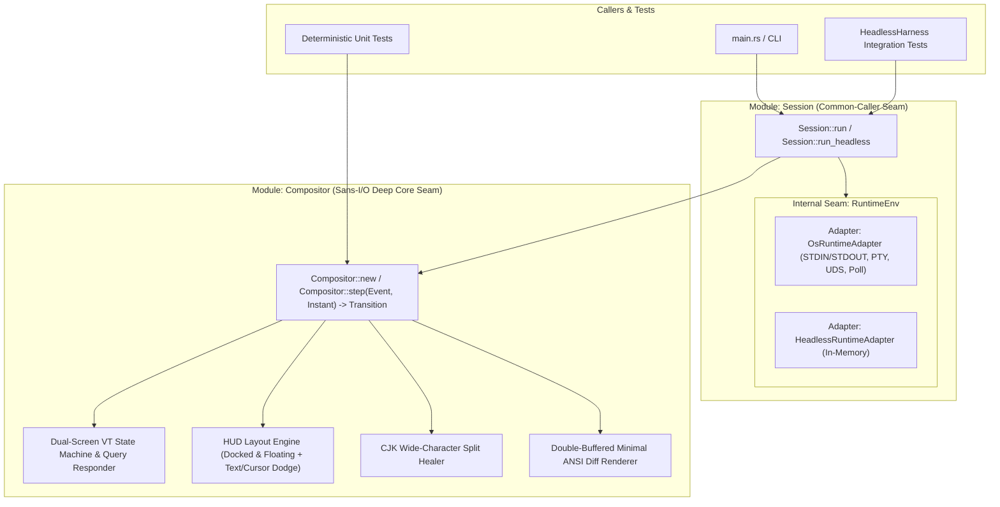

## Architecture Overview

Following the `codebase-design` principles, `thud` avoids splitting terminal emulation, layout calculation, wide-character healing, widget state merging, and ANSI diff rendering into shallow pass-through modules. Instead, all pure computation and screen state live inside a single **In-process Deep Module** (`Compositor`), wrapped by an ergonomic `Session` runner with an **Internal Seam** for OS I/O.

## Module Responsibilities & Seams

### 1. Core Module: `Compositor` (Sans-I/O Deep Seam)

- **Interface**:
  - `Compositor::new(config: Config, host_size: TermSize) -> Self`
  - `Compositor::step(&mut self, event: Event, now: Instant) -> Transition`
- **Hides**:
  - Dual-screen VT100/ANSI state machine (Primary Screen vs Alternate Screen `?1049h`/`?1049l`) via `vt100::Parser`.
  - Terminal capability/status query responder (`DA1`, `DA2`, `DSR 5/6`, `XTVERSION`, Kitty keyboard, `OSC 10/11`) returning synthetic responses in `Transition::child_pty_input` so shells like `fish` never block on startup.
  - Child PTY viewport deduction (`child_size = host_size - docked_rows`).
  - Non-destructive floating overlay compositing with cursor-collision AND underlying non-whitespace text collision policies (`Ignore`, `AutoHide`, `DodgeToOppositeCorner`).
  - CJK wide-character split healing (replacing orphaned half-width cells with spaces when an overlay edge lands on half of a 2-cell CJK character).
  - Double-buffered cell diffing that emits minimal ANSI sequences (`Transition::host_ansi_diff`) and restores the child's exact cursor coordinates and visibility.

### 2. Outer Module: `Session` (Caller Seam + Internal OS Seam)

- **External Interface**:
  - `Session::run(config: Config) -> Result<i32, SessionError>` for production CLI startup.
  - `Session::run_headless(config: Config, cols: u16, rows: u16) -> Result<HeadlessHarness, SessionError>` for multi-step integration tests.
- **Internal Seam & OS Constraints**:
  - On macOS (XNU), `poll(2)` on `/dev/tty` immediately returns `POLLNVAL (0x20)` rather than `POLLIN`. `OsHostTerminal` therefore polls and configures `STDIN_FILENO` (`0`) directly (which references the underlying slave PTY device) and writes diffs to `STDOUT_FILENO` (`1`).

# Related Concepts
- [Core Terminal HUD & Compositor Requirements](../requirements/core-hud-capabilities.md): satisfies core terminal HUD, full-screen overlay, and widget requirements
