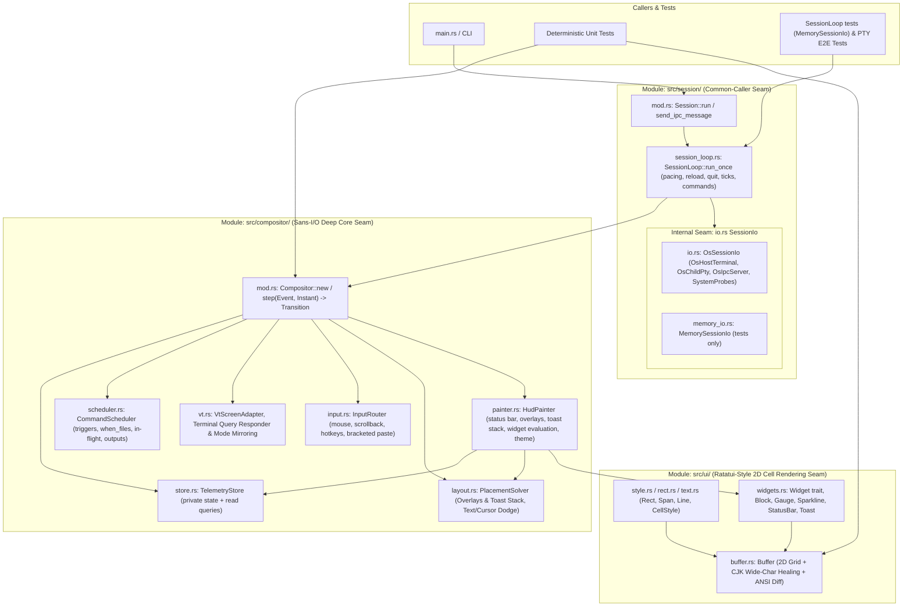

## Architecture Overview

Following the `codebase-design` principles, `thud` preserves deep external seams (`Compositor`, `Session`, `Config`, and `ui`) while organizing implementation responsibilities into focused internal submodules with clean internal seams.

## Module Responsibilities & Seams

### 1. 2D Rendering Foundation: `src/ui/`

- **Interface**:
  - `Rect`, `Span`, `Line`, `Buffer`, and `Widget::render(self, area: Rect, buf: &mut Buffer)`.
- **Hides**:
  - 2D cell coordinate clipping and `Block` border inner-area geometry.
  - Multi-span styled text measurement (`Line::width()`) and rendering.
  - Zero-allocation flat 2D `Cell` grid (`char` inline scalar + `Buffer::clear` + double-buffering).
  - Minimal ANSI SGR/CUP diff emission with virtual run-length cursor tracking (`Buffer::diff(&prev, cursor)`), eliminating 60–80% of cursor position escape codes.
  - Automatic CJK 2-cell wide-character split boundary healing on every cell write.

### 2. Core Module: `src/compositor/` (Sans-I/O Deep Seam)

- **Interface**:
  - `Compositor::new(config: Config, host_size: TermSize) -> Self`
  - `Compositor::step(&mut self, event: Event, now: Instant) -> Transition`
  - `Compositor::render(&mut self, now: Instant) -> Option<Vec<u8>>`
  - `Compositor::is_dirty(&self) -> bool`
- **Internal Submodules**:
  - `store.rs` (`TelemetryStore`, ADR-007): Holds ephemeral IPC slots, metric ring buffers, stacked toast notifications, dynamic overlays, builtin values, and the foreground command timer behind private fields; mutated only via `on_tick` / `apply_ipc` / `push_metric` and read through queries. It renders nothing.
  - `painter.rs` (`HudPainter`, ADR-007): Paints the status bar, overlays (sorted by `z_index`), and toast stack over the projected child screen; evaluates each `WidgetSpec` into styled `Line`s and resolves theme colors, including themed toast and progress colors. A single `effective_widgets` walk (config + dynamic overlays) serves `HudPainter`, `CommandScheduler`, and `watched_markers`.
  - `scheduler.rs` (`CommandScheduler`, ADR-005): Decides when `command` widgets and metric `cmd`s are due (`interval` / `cwd` / `change` triggers, `when_files` markers reported through `BuiltinValues::found_markers`), never re-dispatches a command still in flight, keeps the previous output when a run fails, re-runs only changed specs after reload, and keys commands with the typed `CommandKey` (`Widget(id)` / `Metric(key)`). `Compositor::watched_markers` exposes the marker names to resolve.
  - `vt.rs` (`VtScreenAdapter`): Wraps `vt100::Parser` (Primary/Alternate screen), copies virtual terminal cells into `Buffer`, synthesizes replies to terminal queries (`DA1`, `DA2`, `DSR 5/6`, `XTVERSION`, Kitty keyboard, `OSC 10/11`), and exposes the child's input modes (bracketed paste, application cursor keys, application keypad). `Compositor::render` mirrors any mode change to the host ahead of the frame diff (ADR-008); the OS adapter resets them on exit.
  - `input.rs` (`InputRouter`, ADR-008): Classifies host input into bytes for the child and HUD actions (scroll, snap back, zen toggle, reload) in arrival order. Holds an incomplete SGR/X10 mouse report until the rest arrives (a lone `ESC` / `ESC [` is forwarded immediately), forwards bracketed pastes verbatim without interpreting hotkeys, and remaps SGR mouse rows for a top status bar. Hotkeys are validated when the config is loaded (`Hotkey`).
  - `layout.rs` (`PlacementSolver`): Computes child PTY viewport size, resolves floating overlay bounding-box positions with cursor and non-whitespace text collision dodging (`Ignore`, `AutoHide`, `DodgeToOppositeCorner`), and places the toast stack as one box under `[toast].collision`.
- **Decoupled Ingestion & Pacing**:
  - Byte ingestion (`Event::PtyOutput`) updates virtual screen state and sets a dirty flag immediately without triggering frame rendering.
  - Frame composition (`render`) is paced by the session loop at ~144 FPS (6.9ms interval), while interactive host keystrokes (`Event::HostInput`) trigger an immediate 0ms flush.

### 3. Outer Module: `src/session/` (Caller Seam + Internal OS Seam)

- **External Interface**:
  - `Session::run(config: Config, config_path: Option<PathBuf>) -> Result<i32, SessionError>`
  - `Session::send_ipc_message(socket_path: Option<PathBuf>, msg: &IpcMessage) -> Result<(), SessionError>`
- **Session Loop (ADR-004)**:
  - `session_loop.rs` (`SessionLoop<Io: SessionIo>`): owns every runtime policy of a live session — 144 FPS pacing with immediate flush on host input, the dynamic wait timeout, `SIGWINCH` / `SIGTERM`, child exit, IPC and `Quit`, periodic command dispatch, the 250ms telemetry tick, and config reload with an `Error` toast on invalid config — driven one iteration at a time via `run_once()`.
  - `io.rs` (`SessionIo`): the single crate-internal port for host terminal, child PTY, IPC, signals, commands, probes, clocks, and config source. `OsSessionIo` is the production adapter.
  - `memory_io.rs` (`MemorySessionIo`, test-only): queued inputs, a virtual clock advanced by `SessionLoop::advance`, and recorded host writes, child input, resizes, and spawned commands.
- **OS Submodules**:
  - `tty.rs` (`OsHostTerminal`): Direct `STDIN_FILENO` (`0`) raw mode configuration and poll descriptor, atomic `SIGWINCH` and `SIGTERM`/`SIGHUP`/`SIGINT` graceful shutdown signal interception, terminal device name resolution (`get_tty_name`), and alternate screen buffer restoration.
  - `pty.rs` (`OsChildPty`): Manages `forkpty`, `TIOCSWINSZ`, non-blocking PTY I/O, child lifecycle cleanup (`SIGHUP` on drop), and explicitly sets the child session variables (`THUD_SOCKET`, `THUD_ACTIVE`, `THUD_TTY`; `THUD_TTY` removed when the host TTY has no name).
  - `inherited.rs` (`InheritedSession`, ADR-006): Reads the inherited `THUD_*` variables once and classifies the launch as `Fresh`, `OtherTerminal`, `Stale`, or `Nested` from the current TTY and a socket liveness probe, as a pure function. `remove_socket_file` deletes a path only if it is a Unix socket.
  - `ipc.rs` (`OsIpcServer`): Non-blocking Unix domain socket listener and client message sender with automatic socket file removal on drop.
  - `probes.rs` (`SystemProbes`): Stateful OS telemetry collector (`sample(master_fd, child_pid, now, watched_markers) -> BuiltinValues`) that re-resolves the Git branch and `when_files` markers only when the CWD changes or a foreground command finishes, plus an asynchronous background thread for battery sampling.
- **Fail-Safe Session Lifecycle**:
  - Verifies socket liveness and TTY identity before asserting a nested session; a dead parent session's socket is removed and its variables are ignored. The thud process never mutates its own environment.
  - Supports `--force` (`-f`) override to bypass nested checks explicitly.
  - The `--config` path is passed to `Session::run` as a value and read by `OsSessionIo` on live reload; `THUD_CONFIG` is never set by thud.
  - Typed `SessionError::NoActiveSession` / `SessionError::Usage`; idempotent `thud quit` exits with code 0 when no session is reachable.

### 4. Configuration Module: `src/config/`

- **Internal Submodules**:
  - `mod.rs`: Declarative TOML schema (`Config`, `StatusBarConfig`, `OverlayConfig`, `WidgetSpec`) and file loader/writer.
  - `ipc.rs`: Wire protocol types (`IpcMessage`, `ToastLevel`).
  - `default_config.toml`: Annotated default configuration template embedded via `include_str!`.

# Related Concepts
- [Core Terminal HUD & Compositor Requirements](../requirements/core-hud-capabilities.md): satisfies core terminal HUD, full-screen overlay, and widget requirements
