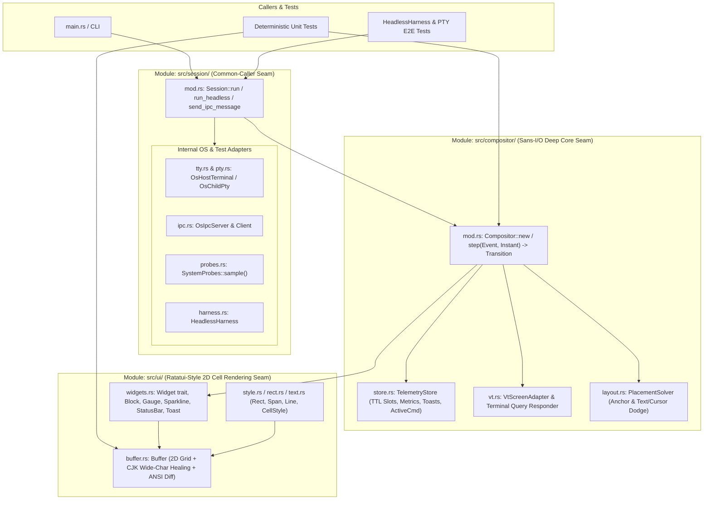

## Architecture Overview

Following the `codebase-design` principles, `thud` preserves deep external seams (`Compositor`, `Session`, `Config`, and `ui`) while organizing implementation responsibilities into focused internal submodules with clean internal seams.

## Module Responsibilities & Seams

### 1. 2D Rendering Foundation: `src/ui/`

- **Interface**:
  - `Rect`, `Span`, `Line`, `Buffer`, and `Widget::render(self, area: Rect, buf: &mut Buffer)`.
- **Hides**:
  - 2D cell coordinate clipping and `Block` border inner-area geometry.
  - Multi-span styled text measurement (`Line::width()`) and rendering.
  - Automatic CJK 2-cell wide-character split boundary healing on every cell write.
  - Double-buffered minimal ANSI SGR/CUP diff emission (`Buffer::diff(&prev, cursor)`).

### 2. Core Module: `src/compositor/` (Sans-I/O Deep Seam)

- **Interface**:
  - `Compositor::new(config: Config, host_size: TermSize) -> Self`
  - `Compositor::step(&mut self, event: Event, now: Instant) -> Transition`
- **Internal Submodules**:
  - `store.rs` (`TelemetryStore`): Manages ephemeral IPC slots, metric ring buffers, stacked toast notifications, periodic command outputs, and foreground command timers.
  - `vt.rs` (`VtScreenAdapter`): Wraps `vt100::Parser` (Primary/Alternate screen), copies virtual terminal cells into `Buffer`, and synthesizes replies to terminal queries (`DA1`, `DA2`, `DSR 5/6`, `XTVERSION`, Kitty keyboard, `OSC 10/11`).
  - `layout.rs` (`PlacementSolver`): Computes child PTY viewport size and resolves floating overlay bounding-box positions with cursor and non-whitespace text collision dodging (`Ignore`, `AutoHide`, `DodgeToOppositeCorner`).

### 3. Outer Module: `src/session/` (Caller Seam + Internal OS Seam)

- **External Interface**:
  - `Session::run(config: Config) -> Result<i32, SessionError>`
  - `Session::run_headless(config: Config, cols: u16, rows: u16) -> Result<HeadlessHarness, SessionError>`
- **Internal Submodules**:
  - `tty.rs` (`OsHostTerminal`): Polls and configures `STDIN_FILENO` (`0`) directly (avoiding macOS XNU `/dev/tty` `POLLNVAL`), writes diffs to `STDOUT_FILENO` (`1`), and tracks `SIGWINCH`.
  - `pty.rs` (`OsChildPty`): Manages `forkpty`, `TIOCSWINSZ`, non-blocking PTY I/O, and child lifecycle.
  - `ipc.rs` (`OsIpcServer`): Non-blocking Unix domain socket listener and client message sender.
  - `probes.rs` (`SystemProbes`): Stateful OS telemetry collector (`sample(master_fd, child_pid, now) -> BuiltinValues`) encapsulating battery cache, CWD, Git branch, and foreground process command inspection.
  - `harness.rs` (`HeadlessHarness`): Deterministic in-memory adapter for multi-step integration tests.

### 4. Configuration Module: `src/config/`

- **Internal Submodules**:
  - `mod.rs`: Declarative TOML schema (`Config`, `StatusBarConfig`, `OverlayConfig`, `WidgetSpec`) and file loader/writer.
  - `ipc.rs`: Wire protocol types (`IpcMessage`, `ToastLevel`).
  - `default_config.toml`: Annotated default configuration template embedded via `include_str!`.

# Related Concepts
- [Core Terminal HUD & Compositor Requirements](../requirements/core-hud-capabilities.md): satisfies core terminal HUD, full-screen overlay, and widget requirements
