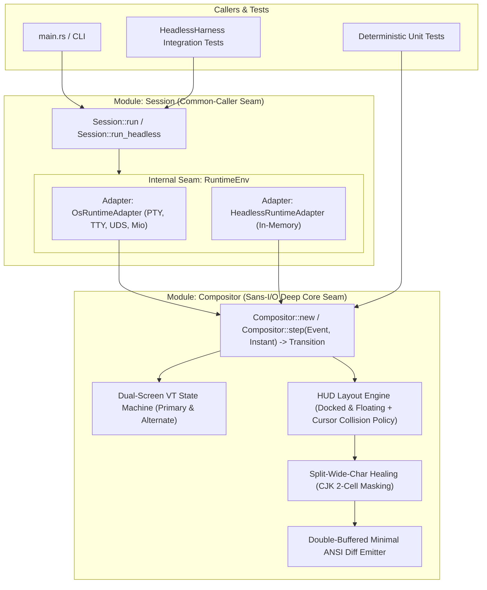

## Architecture Overview

Following the `codebase-design` principles, `cth` avoids splitting terminal emulation, layout calculation, wide-character healing, widget state merging, and ANSI diff rendering into shallow pass-through modules. Instead, all pure computation and screen state live inside a single **In-process Deep Module** (`Compositor`), wrapped by an ergonomic `Session` runner with an **Internal Seam** for OS I/O.

## Core Seams and Interfaces

### 1. Inner Deep Module: `Compositor` (In-Process Seam)

- **Interface**:
  - `Compositor::new(host_size: TermSize, config: Config, now: Instant) -> Result<(Self, Transition), CompositorError>`
  - `Compositor::step(&mut self, event: Event<'_>, now: Instant) -> Transition`
- **What sits behind the seam (Implementation)**:
  - Stateful UTF-8 and VT100/xterm parser across arbitrary byte chunk splits.
  - Primary and Alternate (`?1049h`/`?1049l`) cell grids, scroll regions (`DECSTBM`), and cursor state.
  - `Placement::Docked` (reserving rows via `Transition::child_pty_resize`) and `Placement::Floating` (corner-anchored overlays with `CollisionPolicy::AutoHide` or `DodgeToOppositeCorner` when the child cursor collides with the overlay).
  - Split-wide-character healing when an overlay edge lands on half of a 2-cell CJK character.
  - Double-buffered cell diffing that emits minimal ANSI sequences (`Transition::host_ansi_diff`) and restores the child's exact cursor coordinates and visibility.

### 2. Outer Module: `Session` (Caller Seam + Internal OS Seam)

- **External Interface**:
  - `Session::run(config: Config) -> Result<i32, SessionError>` for production CLI startup.
  - `Session::run_headless(config: Config, cols: u16, rows: u16) -> HeadlessHarness` for multi-step integration tests.
- **Internal Seam (`RuntimeEnv`)**:
  - Connects `OsRuntimeAdapter` (real `/dev/tty` raw mode, `forkpty`, `TIOCSWINSZ`, `SIGWINCH`, Unix domain socket listener, non-blocking `sh -c` process pool) or `HeadlessRuntimeAdapter` to `Compositor::step`.

# Related Concepts
- [Core Terminal HUD & Compositor Requirements](../requirements/core-hud-capabilities.md): satisfies core terminal HUD, full-screen overlay, and widget requirements
