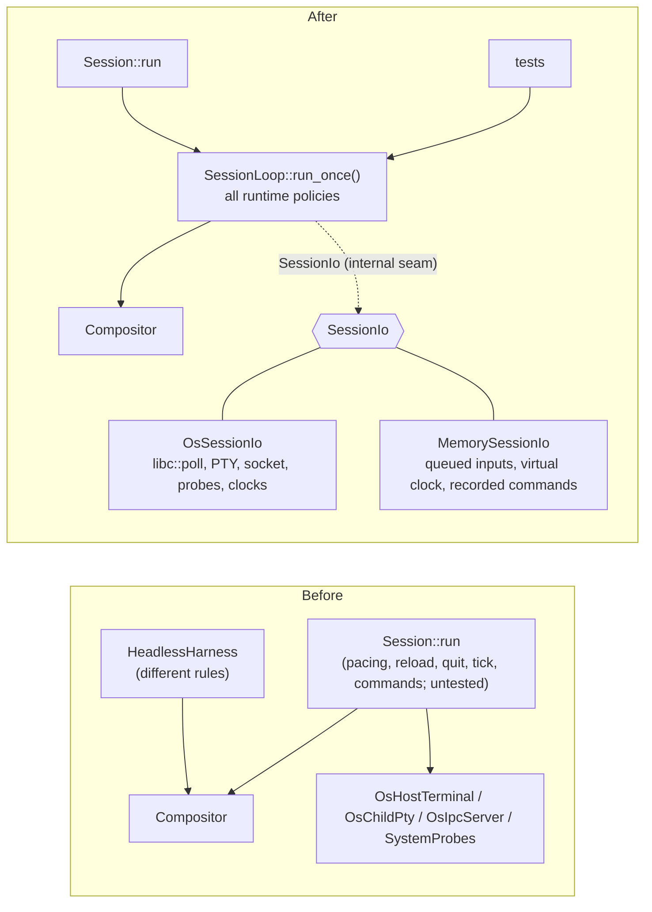
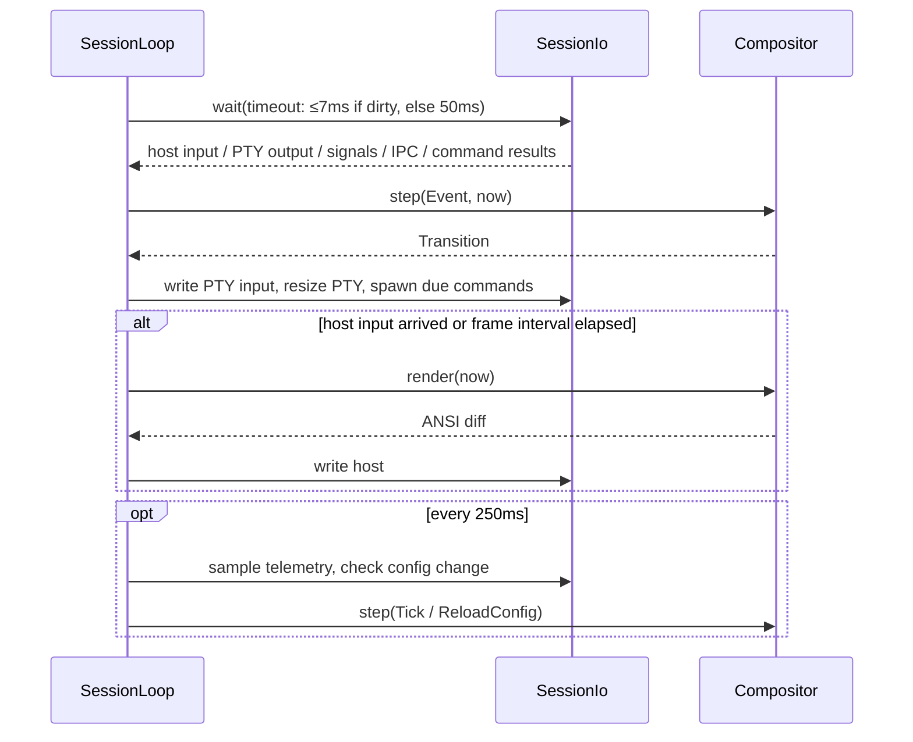

## Context

`Session::run` owns every runtime policy of a live session: 144 FPS frame pacing with an immediate flush on host input, the dynamic `poll` timeout (≤7ms when dirty, 50ms when clean), `SIGWINCH` / `SIGTERM` intake, child exit propagation, IPC draining and `IpcMessage::Quit`, spawning due periodic commands on background threads, the 250ms tick with `SystemProbes` sampling, and config mtime watching with reload (plus an `Error` toast when the reloaded config is invalid).

None of these policies had a unit test. ADR-001 decided that the OS ports (`HostTerminal`, `ChildPty`, `UnixSocket`, `CommandPool`) would sit behind an **internal seam**, but the implementation wired concrete `OsHostTerminal` / `OsChildPty` / `OsIpcServer` directly into the loop body, so the seam never existed.

`HeadlessHarness` drove the same `Compositor` with different rules: it rendered after every step (no pacing), discarded `Transition::reload_config` and `child_pty_input`, ignored the initial `due_commands` from `Compositor::new`, and never saw `Quit`. Tests passing through the harness therefore did not certify production behaviour.

## Decision

1. **`SessionLoop` owns the loop.** A new crate-internal `SessionLoop<Io: SessionIo>` holds every runtime policy listed above and is driven one iteration at a time via `run_once()`. `Session::run` builds the OS adapter and repeats `run_once()` until it yields an exit code.
2. **One port trait, two adapters.** All OS dependencies are bundled into a single `pub(crate) trait SessionIo` (static dispatch): waiting on host/PTY readiness with a timeout (the `poll`), reading and writing the host terminal and child PTY, resizing the PTY, draining IPC messages, signals, child exit status, spawning periodic commands and collecting their output, sampling builtin telemetry, monotonic time (`Instant`), wall-clock time (`DateTime<Local>`), and config change detection/loading.
   - `OsSessionIo`: production adapter wrapping `OsHostTerminal`, `OsChildPty`, `OsIpcServer`, `SystemProbes`, and `libc::poll`.
   - `MemorySessionIo`: deterministic in-memory adapter with a virtual clock. Test inputs (host input, PTY output, IPC, resize, SIGTERM, child exit, config change) are only enqueued; `advance(Duration)` moves virtual time while running `run_once()`. Virtual time never advances implicitly to flush a frame. Spawned commands are recorded as `(id, cmd, cwd)` and completed explicitly by the test.
   - The bundle (rather than one trait per port) reflects that only two combinations exist — all-OS or all-in-memory — and that host and PTY readiness must be awaited in a single `poll`. It also keeps generic port traits out of the public interface, the weakness that ruled out Design 4 in ADR-001.
3. **Outside the loop**: nested-session checks, raw-mode entry, socket path selection, shell resolution, and `forkpty` remain in adapter construction inside `Session::run`.
4. **`HeadlessHarness` and `Session::run_headless` are removed** (along with the `lib.rs` re-export). Tests construct `SessionLoop<MemorySessionIo>` directly.
5. **Defects found while porting are fixed in place** (e.g. the reload path rendering without updating the last-frame timestamp).

### Before / After

### One iteration of `run_once()`

## Consequences

- **Locality**: every session runtime policy lives in `SessionLoop`; OS specifics live only in `OsSessionIo`.
- **Leverage**: production and tests cross the same seam, so a passing `MemorySessionIo` test certifies production loop behaviour.
- **Testing**: new tests cover frame pacing and immediate flush, config reload (mtime, invalid config toast, `reload_key`, IPC reload), exit paths (IPC `Quit`, `SIGTERM`, child exit code), initial due commands with cwd hand-off, and `SIGWINCH` resize.
- **Public interface**: `Session::run` and `Session::send_ipc_message` are unchanged; `Session::run_headless` and `HeadlessHarness` disappear from the crate's public interface.
- Later candidates build on this seam: the command-scheduling redesign (typed command ids) and the session-identity redesign (`THUD_*` environment) reuse `SessionIo`'s in-memory adapter for testing.

# Related Concepts
- [Deep Compositor & Session Module Architecture](../architecture/compositor-module.md): realizes the internal OS seam of the Session module as SessionLoop over SessionIo
- [ADR-001: Design It Twice Evaluation for Compositor and Session Seams](adr-001-design-it-twice-compositor-seam.md): implements the internal OS port seam decided in ADR-001 without leaking generic port traits
