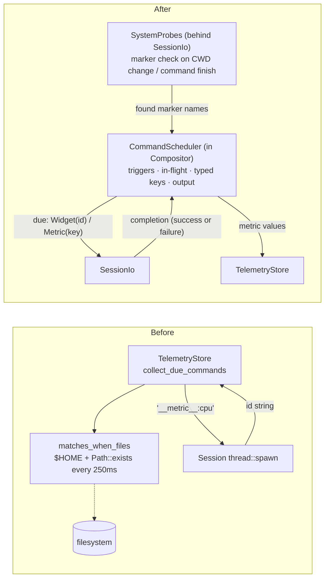
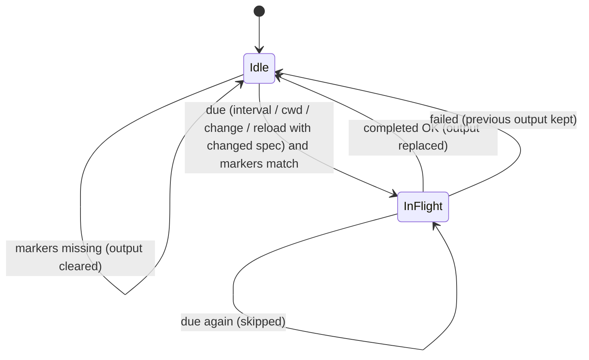

## Context

Periodic and event-driven shell commands (`command` widgets, and `sparkline` / `gauge` widgets with `cmd`) were scheduled by `TelemetryStore::collect_due_commands` and interpreted by `TelemetryStore::on_command_output`. Three problems followed:

1. **Sans-I/O violation inside `Compositor`**: `when_files` was evaluated by `matches_when_files`, which read `$HOME` (to expand the `~/` display form of the CWD back into a path) and walked every ancestor directory with `Path::exists()` on every 250ms tick for every command widget. This broke ADR-001's Sans-I/O invariant and ADR-003's "zero steady-state filesystem I/O on ticks".
2. **Stringly-typed protocol across modules**: metric commands were encoded as `"__metric__:<key>"` ids that travelled from `TelemetryStore` through `Transition::due_commands`, `Session`, the test harness, and back through `Event::CommandOutput`. A `command` widget whose id began with `__metric__:` would be misinterpreted.
3. **Unbounded and stale scheduling**: a command slower than its interval was spawned again on every interval; a failed spawn produced no completion; and on config reload a command keeping its id but changing its `cmd` was not re-run until its next trigger.

## Decision

1. **`CommandScheduler` inside `Compositor`.** A new internal module owns trigger evaluation (`interval`, `cwd`, `change`), `when_files` matching, in-flight tracking, last-run timestamps, and output interpretation and storage. Only metric values are forwarded to `TelemetryStore`.
2. **Typed command keys.** The `"__metric__:"` prefix is replaced by an enum distinguishing widget commands (by widget id) from metric commands (by metric key). The due commands in `Transition` and `Event::CommandOutput` carry this type.
3. **Filesystem checks move behind `SessionIo`.** `Compositor` exposes the set of watched marker file names (including those from IPC-injected dynamic overlays); `SessionLoop` hands it to `SystemProbes`, which reports the names found in the CWD's ancestors through `BuiltinValues`. `Compositor` only matches sets. `expand_tilde_path` is deleted.
4. **Re-check cadence.** Marker presence — and, by the same rule, the Git branch — is re-evaluated only when the CWD changes or a foreground command finishes, so steady-state ticks perform no filesystem I/O while files created by a command (e.g. `cargo init`) and branch switches (e.g. `git switch`) are still picked up.
5. **No overlapping runs.** A command whose previous run is still in flight is not dispatched again.
6. **Completion is always reported.** `SessionIo` reports every dispatched command's completion, success or failure. On failure the in-flight flag is cleared and the previous output is kept on screen.
7. **Reload re-runs only changed commands.** On config reload, commands with a new id or a changed `cmd`, `trigger`, or `when_files` run immediately; unchanged commands keep their output and schedule.

### Before / After

### Command lifecycle

## Consequences

- **Locality**: everything about when a command runs and what its output means lives in `CommandScheduler`.
- **Sans-I/O restored**: `Compositor` tests no longer depend on `$HOME` or the disk.
- **Testing**: through `MemorySessionIo` (ADR-004), tests assert dispatch timing, `when_files` gating, in-flight suppression, failure handling, and reload behaviour by completing recorded commands explicitly.
- **Behaviour changes**: no overlapping runs, failure keeps the previous output, reload re-runs changed commands, and markers created in an unchanged CWD are detected after the next foreground command finishes rather than within 250ms.

# Related Concepts
- [Deep Compositor & Session Module Architecture](../architecture/compositor-module.md): adds CommandScheduler as an internal submodule of Compositor and restores its Sans-I/O invariant
- [ADR-004: SessionLoop and SessionIo Internal Seam](adr-004-session-loop-and-session-io-seam.md): routes command dispatch, completion, and marker-file checks through the SessionIo seam
