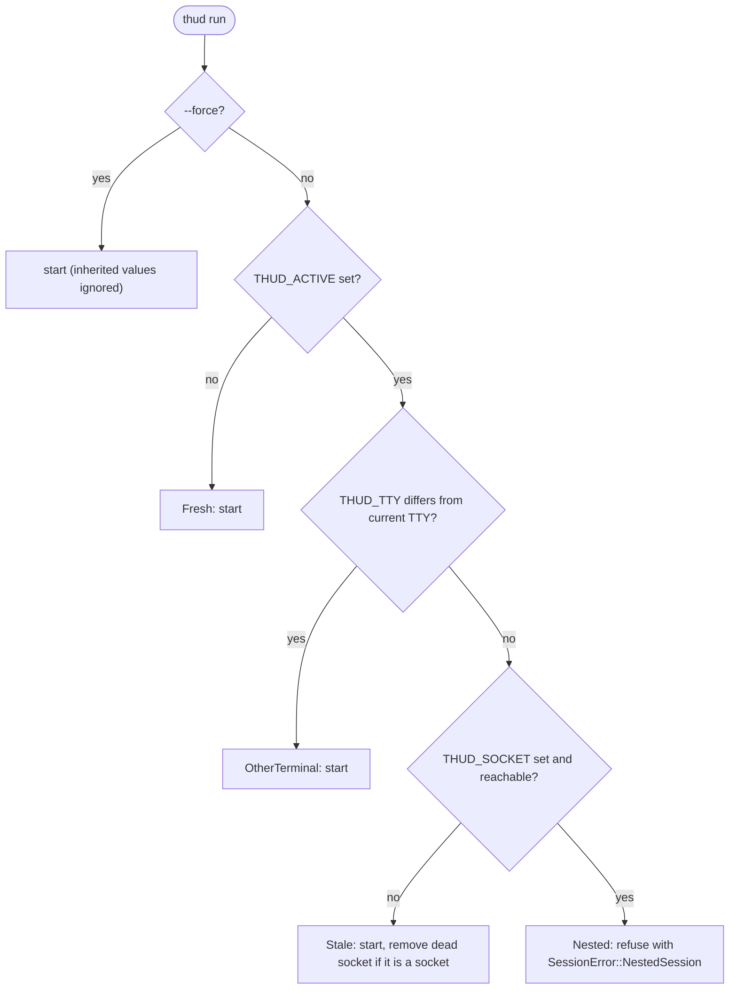
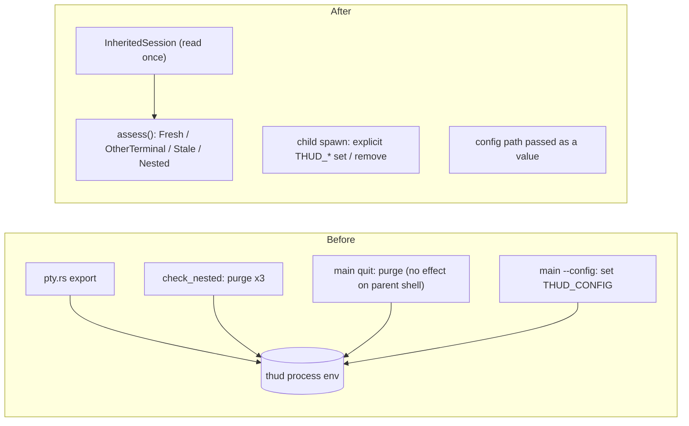

## Context

Knowledge of the `THUD_*` environment variables was spread across five places:

- `session/pty.rs` exported `THUD_SOCKET`, `THUD_ACTIVE`, and `THUD_TTY` into the child shell.
- `Session::check_nested_session_impl` decided whether a launch is nested and purged the variables from the thud process with `remove_var` in three separate branches; it also deleted the file named by an unreachable `THUD_SOCKET` without checking that it was a socket.
- `main.rs` (`thud quit`) matched the error text `"no active thud session reachable"` / `"THUD_SOCKET is not set"` and then purged the variables from its own process, which cannot affect the parent shell, while printing "Cleaned up environment."
- `main.rs` (`--config`) called `set_var("THUD_CONFIG")` so that reload would find the file, which also leaked the path into the child shell.
- `session/ipc.rs` and `Config::default_path` read `THUD_SOCKET` / `THUD_CONFIG`.

Tests exercised the nesting rules by mutating the process environment with `std::env::set_var`, which is process-global and races with other tests running in parallel.

## Decision

1. **`InheritedSession` value + pure assessment.** The inherited `THUD_ACTIVE`, `THUD_SOCKET`, and `THUD_TTY` are read once into an `InheritedSession` value. `assess` takes the current TTY name and a socket liveness probe and returns one of `Fresh`, `OtherTerminal`, `Stale`, or `Nested`. No environment port is introduced: tests construct values directly.
2. **No process-environment mutation.** All `set_var` / `remove_var` calls are removed. The child shell's `THUD_SOCKET`, `THUD_ACTIVE`, and `THUD_TTY` are set or removed explicitly at spawn time (`THUD_TTY` is removed when the host TTY has no name). The `--config` path is passed to `Session` as a value (the config source of ADR-004) and `THUD_CONFIG` is no longer inherited by the child.
3. **`thud quit` without a session** prints that no session is running and exits 0, without touching any environment.
4. **Dead sockets are removed only if they are sockets.** The same rule applies when `OsIpcServer::bind` clears an existing path.
5. **Typed errors.** `SessionError::NoActiveSession { socket }` and `SessionError::Usage(String)` are added; `thud quit` branches on the type, and `SessionError::Ipc` is left for real transport and encoding failures.

### Assessment rules

### Who touches `THUD_*`

## Consequences

- **Locality**: nesting rules live in one pure function; child environment construction lives in one place at spawn time.
- **Testing**: every assessment branch is covered by passing values; tests no longer mutate the process environment.
- **Safety**: no `unsafe` environment mutation; a mistyped `THUD_SOCKET` can no longer delete a regular file.
- **Behaviour changes**: `thud quit` no longer claims to clean the environment; a nested `thud` started inside a session launched with `--config` no longer inherits that config path.

# Related Concepts
- [Deep Compositor & Session Module Architecture](../architecture/compositor-module.md): redefines the Session module's fail-safe nested-session lifecycle around InheritedSession
- [ADR-004: SessionLoop and SessionIo Internal Seam](adr-004-session-loop-and-session-io-seam.md): passes the --config path to the SessionIo config source as a value instead of THUD_CONFIG
