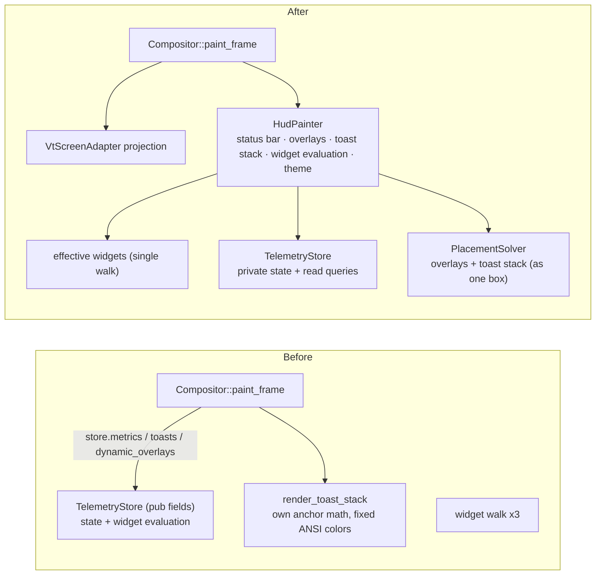
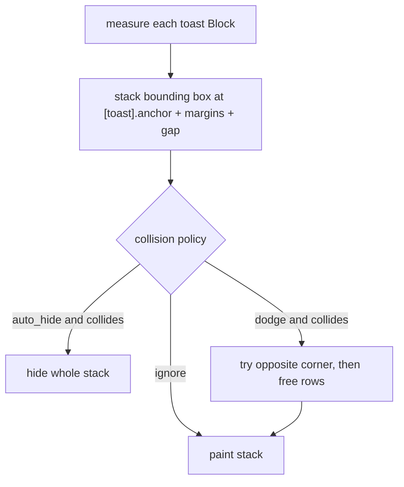

## Context

`TelemetryStore` mixed two jobs: holding HUD state (IPC slots, metric series, toasts, dynamic overlays, builtins, the foreground command timer) and turning `WidgetSpec`s into styled `Line`s with theme resolution (`evaluate_widget_lines`, `build_segment_line`, `resolve_widget_style`). Every field was `pub`, and `Compositor::paint_frame` / `render_toast_stack` read `store.metrics`, `store.toasts`, and `store.dynamic_overlays` directly.

The walk over "all widgets" (status bar sections + config overlays + IPC-injected dynamic overlays) was duplicated in `collect_due_commands`, `is_metric_referenced`, and `paint_frame`, and ADR-005 adds a fourth consumer (watched marker files).

The toast stack computed its own anchor geometry inside `Compositor` instead of using `PlacementSolver`, never avoided the child cursor, and used fixed ANSI 256-color values (`ToastLevel::palette`, `CellStyle::ansi(231, 25, ..)` for progress gauges) that ignored the theme.

Compositor tests mutated internal state directly (e.g. `comp.config.overlays.clear()`).

## Decision

1. **`HudPainter` inside `Compositor`.** A new internal module paints the status bar, overlays, and toast stack into a `Buffer`, owning widget evaluation and theme resolution moved out of `TelemetryStore`. `Compositor::paint_frame` projects the VT screen and then delegates to `HudPainter`.
2. **`TelemetryStore` is closed.** Its fields become private; it exposes read queries for slots, metrics, toasts, dynamic overlays, builtins, and the foreground command timer, and is mutated only through `on_tick` / `apply_ipc`. It no longer renders anything.
3. **One widget walk.** A single query yields the effective widgets (config + dynamic overlays). `CommandScheduler`, the metric-referenced check, the watched-marker list, and `HudPainter` all use it.
4. **Toast placement in `PlacementSolver`.** The stack is placed as one bounding box and avoids collisions as a unit.
5. **`[toast] collision`** uses the overlay `CollisionPolicy` schema, defaulting to `dodge_to_opposite_corner` with `margin = 1` and `avoid_text = false`, so notifications move away from the cursor but never disappear because of underlying text.
6. **Themed toast colors.** `ThemePalette` gains fg/bg pairs for toast `info` / `success` / `warn` / `error` and for IPC progress gauges, defined for every preset and overridable from `[theme]`. The `default` theme keeps today's ANSI values. `ToastLevel` keeps only its icon.
7. **Docs and tests follow.** `template.rs`, `guides/configuration.md`, and `README.md` document the new keys; tests stop poking internals and use `Event::ReloadConfig` instead.

### Before / After

### Toast stack placement

## Consequences

- **Locality**: HUD painting and widget evaluation live in `HudPainter`; HUD state lives behind `TelemetryStore`'s queries; all placement geometry lives in `PlacementSolver`.
- **Leverage**: one widget walk serves four consumers.
- **Testing**: `HudPainter` is tested by giving it state and inspecting the `Buffer`, without a VT; toast stacking and avoidance are tested as pure geometry in `PlacementSolver`.
- **Behaviour changes**: toasts now move away from the cursor by default, and non-default themes color toasts and progress gauges from their palettes.

# Related Concepts
- [Deep Compositor & Session Module Architecture](../architecture/compositor-module.md): adds HudPainter and narrows TelemetryStore inside the Compositor module
- [ADR-005: CommandScheduler, Typed Command Keys, and Filesystem Checks Behind SessionIo](adr-005-command-scheduler-and-typed-command-keys.md): provides the single effective-widget walk consumed by CommandScheduler
