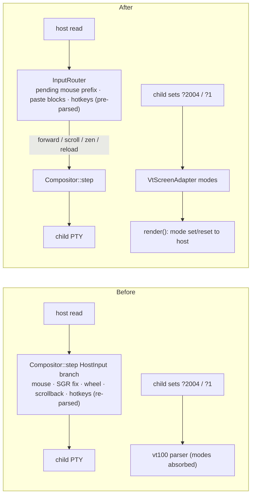
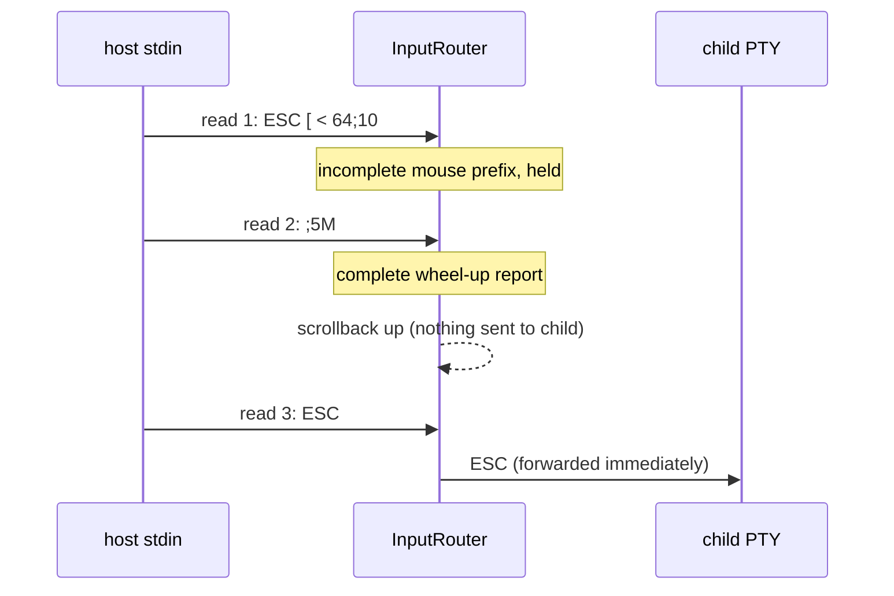

## Context

`Compositor::step` handled `Event::HostInput` inline in a ~65-line branch: mouse report parsing, SGR row adjustment for a top status bar, wheel-to-arrow translation on the alternate screen, scrollback scrolling and snap-back, and the zen/reload hotkeys. Three defects lived there:

1. **Split escape sequences leaked.** `parse_mouse_event` only recognized a complete report at the start of a single read. A report split across two reads (e.g. `ESC [ < 64;10` then `;5M`) was forwarded byte by byte to the child shell as garbage.
2. **Hotkeys were re-parsed on every input** with `Config::parse_hotkey_byte`, and an invalid hotkey string (e.g. `"ctrl-1"`) silently disabled the hotkey.
3. **Child terminal modes never reached the host.** Modes the child enabled — bracketed paste (`?2004`), application cursor keys (`?1`), application keypad — were absorbed by the `vt100` parser; the host only ever received `?1049h ?1000h ?1006h` at startup. Inside thud, a multi-line paste was not bracketed, so shells could execute each pasted line immediately.

## Decision

1. **`InputRouter` inside `Compositor`.** A new internal module classifies host input into: bytes forwarded to the child, scrollback moves, hotkey actions (zen toggle, reload), and paste blocks. `Compositor::step` applies its result.
2. **Pending mouse prefixes only.** An incomplete report beginning with `ESC [ <` or `ESC [ M` is held until the next input. A lone `ESC` or `ESC [` is forwarded immediately so the Esc key is never delayed and no timer is needed.
3. **Host mode mirroring.** `VtScreenAdapter` exposes the child's bracketed-paste, application-cursor, and application-keypad modes; `Compositor` emits set/reset sequences for any change as part of its rendered host output. On exit the OS adapter resets these modes along with the existing restore sequence.
4. **Paste blocks are opaque.** Bytes between `ESC [ 200 ~` and `ESC [ 201 ~` are forwarded verbatim; hotkey bytes inside are not interpreted, and scrollback snaps back once.
5. **Hotkeys are validated at load.** `zen_toggle_key` and `reload_key` deserialize into a hotkey type; an invalid value is a `ConfigError` (startup fails; reload shows the ADR-004 error toast).

### Before / After

### Split mouse report

## Consequences

- **Locality**: every rule about what a host keystroke means lives in `InputRouter`.
- **Correctness**: split mouse reports no longer leak into the shell; pastes are bracketed whenever the child asks for it; hotkeys inside pastes are inert.
- **Testing**: all routing rules are exercised through `Compositor::step` with byte fixtures, including split reads, paste blocks, mode mirroring output, and invalid hotkeys.
- **Behaviour changes**: an invalid hotkey string is now an error instead of silently disabling the hotkey.

# Related Concepts
- [Deep Compositor & Session Module Architecture](../architecture/compositor-module.md): adds InputRouter to the Compositor module and mirrors child terminal modes to the host
- [ADR-004: SessionLoop and SessionIo Internal Seam](adr-004-session-loop-and-session-io-seam.md): relies on the reload error toast and OS adapter exit restore defined by ADR-004
