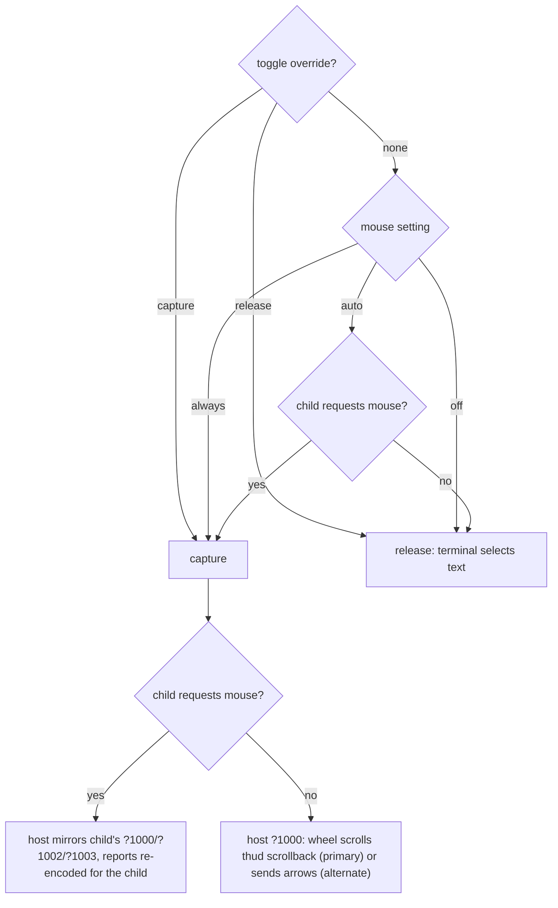
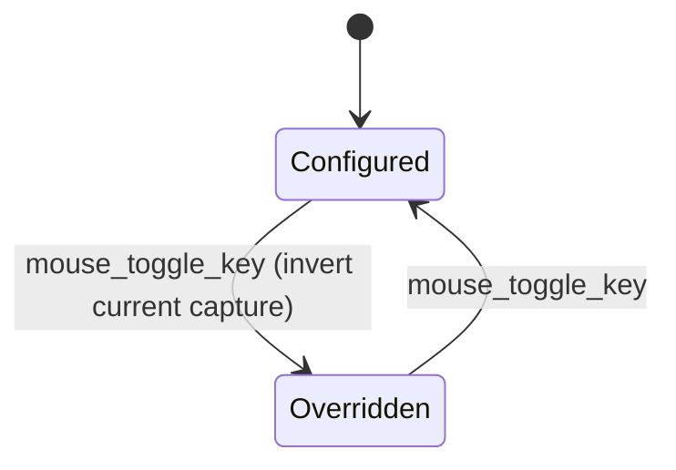

## Context

`OsHostTerminal::enter` always enabled host mouse reporting (`?1000h ?1006h`) so the mouse wheel could scroll thud's own scrollback. While mouse reporting is on, terminals send clicks and drags to the application instead of selecting text, so users could not select or copy terminal output inside thud. The workaround is a terminal-specific modifier (e.g. Shift-drag, or VS Code's `terminal.integrated.macOptionClickForcesSelection`). Even then only the visible screen could be selected, because thud draws on the host's alternate screen.

The host was also fixed at `?1000` (press/release). A child that asked for drag (`?1002`) or any-motion (`?1003`) tracking — e.g. visual selection by dragging in vim — never received motion events. Every child also received SGR-encoded reports, whatever encoding it had requested.

Options considered:

- **A. Follow the child**: enable host mouse reporting only while the child requests mouse tracking. Native selection works at the shell; the wheel no longer scrolls thud's scrollback there.
- **B. Selection inside thud**: draw a highlight and copy via OSC 52. This works with wheel scrollback and across scrollback, but needs much more code and depends on the terminal's OSC 52 support.
- **C. Toggle hotkey**: switch mouse capture on demand.

## Decision

Adopt **A + C**. B is left for later if A + C proves insufficient.

1. **`mouse = "auto" | "always" | "off"`** (default `auto`). In `auto`, the host reports the mouse only while the child requests mouse tracking. `always` keeps the previous behaviour (the wheel scrolls thud's scrollback at the shell); `off` never captures the mouse.
2. **`mouse_toggle_key`** (default `ctrl-^`). The first press overrides capture to the opposite of the current state: release it to the terminal for native selection (even inside vim), or capture it for wheel scrollback. The next press removes the override and returns to the configured mode. Each switch shows a short info toast (`Mouse: thud (scroll)`, `Mouse: terminal (select)`, `Mouse: <mode>`). It conflicts with vim's `CTRL-^` (alternate file), which can be remapped in the config.
3. **Tracking level and encoding are mirrored.** While capturing, the host uses the child's tracking level (`?1000` / `?1002` / `?1003`; `?1000` when thud captures for itself) with SGR reports. `InputRouter` re-encodes each report in the encoding the child requested (SGR or the classic `ESC [ M` bytes).
4. **Host mode mirroring owns mouse modes.** The mouse mode joins `TerminalModes` from ADR-008, so `Compositor::render` emits any change ahead of the frame diff. The fixed `?1000h ?1006h` at startup is removed.
5. **Wheel without capture does nothing.** The OS adapter disables alternate scroll (`?1007l`) on entry, so the wheel is not turned into arrow keys that would walk shell history. On exit it resets every mouse mode and re-enables alternate scroll (`?1007h`).

### Who receives the mouse

### Toggle states

## Consequences

- **Copy works by default**: at the shell prompt, terminals select and copy text natively.
- **Mouse apps work better**: drag and motion tracking reach the child, in its own encoding.
- **Trade-off**: in `auto`, the wheel no longer scrolls thud's scrollback at the shell. Users opt in with the hotkey or `mouse = "always"`.
- **Verification**: the behaviour of `?1007` and native selection is checked by hand in the VS Code integrated terminal and Ghostty.

# Related Concepts
- [ADR-008: InputRouter and Host Terminal Mode Mirroring](adr-008-input-router-and-host-mode-mirroring.md): extends host mode mirroring and InputRouter to mouse tracking modes and encodings
- [Deep Compositor & Session Module Architecture](../architecture/compositor-module.md): changes how the Compositor decides host mouse reporting
