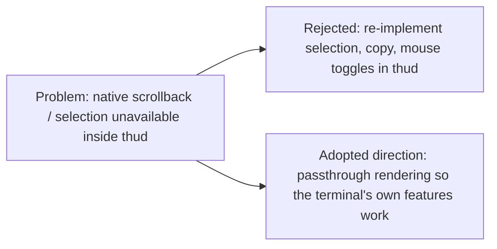

## Status

**Rejected** (2026-10-23). It was implemented on an unmerged branch and then discarded.

## Context

thud draws the child screen on the host's alternate screen, so the terminal's native scrollback, selection, search, and wheel scrolling cannot reach thud's history. ADR-009 added mouse capture and a `mouse_toggle_key`. This ADR proposed that, while thud captures the mouse, thud itself implements selection across its scrollback: drag, word, line, block, and extend gestures, auto-scroll, copy via `pbcopy` / OSC 52, and holding output while dragging.

## Decision

Do not adopt thud-side selection or keyboard-driven mode switching.

**Reason**: thud is meant to be a HUD, not a terminal or multiplexer. Rebuilding terminal features inside thud (selection, copy, mouse modes switched by hotkeys) contradicts that goal and makes the terminal and shell less transparent. The friction comes from the alternate-screen rendering model. It is addressed by changing that model so the terminal's own scrollback, selection, and search work unmodified — passthrough rendering, recorded in a follow-up ADR.

## Consequences

- Future reviews should not re-propose thud-side selection, copy modes, or hotkeys that switch terminal behaviour. Prefer designs that leave terminal and shell behaviour untouched.
- `mouse_toggle_key` and thud-captured wheel scrolling from ADR-009 are revisited by the passthrough rendering design.

# Related Concepts
- [ADR-009: Mouse Capture Modes for Native Text Selection](adr-009-mouse-capture-modes.md): rejects extending ADR-009's mouse capture with thud-side selection
