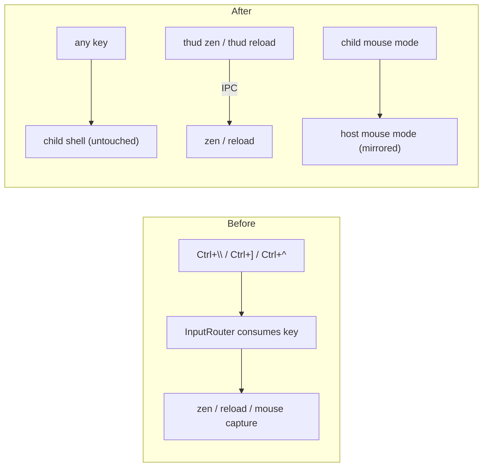

## Context

thud intercepted three keys before they reached the shell:
- `zen_toggle_key` (default `Ctrl+\`), which also collides with SIGQUIT in cooked mode;
- `reload_key` (default `Ctrl+]`);
- `mouse_toggle_key` (default `Ctrl+^`), which collides with vim's alternate-file key.

ADR-009 also let thud capture the mouse for itself (`mouse = "auto" | "always" | "off"` plus the toggle). The aim was to work around the alternate-screen rendering model. Reviewing ADR-010 (rejected), the user set a guiding principle: **thud is only a HUD**. Terminal and shell behaviour must stay transparent, so thud must neither consume keys nor switch terminal behaviour with shortcuts.

## Decision

1. **No key interception.** `zen_toggle_key`, `reload_key`, and `mouse_toggle_key` are removed, and every byte the user types reaches the child. `InputRouter` keeps only input classification: mouse routing, split mouse reports, opaque bracketed pastes, and submitted-line detection.
2. **CLI instead of hotkeys.** `thud zen [on|off]` (toggle without an argument) sends `IpcMessage::Zen { enabled }`. Reload stays automatic on save, plus `thud reload`. Users who want a key bind `thud zen` in their shell (zsh `zle`, fish `bind`, bash `bind -x`).
3. **thud never captures the mouse.** The `mouse` setting is removed. Host mouse reporting mirrors exactly what the child requests (tracking level and encoding as in ADR-009), so the terminal's native selection works whenever the child has not asked for the mouse. This supersedes the capture modes and toggle of ADR-009.
4. **Old config keys are ignored.** `Config` does not reject unknown keys, so existing config files keep loading.

## Consequences

- **Transparency**: thud no longer steals `Ctrl+\`, `Ctrl+]`, or `Ctrl+^` from shells, vim, or telnet-style programs.
- **Trade-off**: until passthrough rendering lands, wheel-scrolling thud's own scrollback at the shell is unavailable, because thud no longer captures the wheel there.
- **Follow-up**: passthrough rendering (a later ADR) replaces the alternate-screen model, so the terminal's native scrollback, selection, and search cover the session.

# Related Concepts
- [ADR-009: Mouse Capture Modes for Native Text Selection](adr-009-mouse-capture-modes.md): supersedes ADR-009's capture modes and mouse_toggle_key; keeps its mode mirroring
- [ADR-010 (Rejected): thud-Side Selection and Keyboard Mode Switching](adr-010-rejected-thud-side-selection.md): applies the HUD-only principle established when ADR-010 was rejected
- [Deep Compositor & Session Module Architecture](../architecture/compositor-module.md): removes hotkeys from InputRouter and mouse capture from the Compositor
